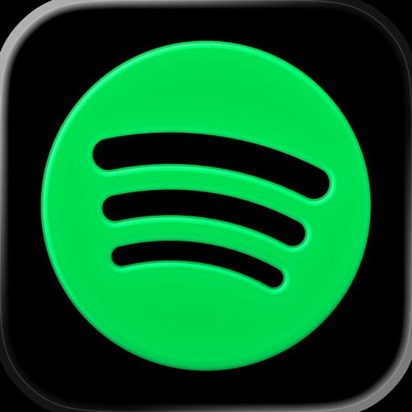
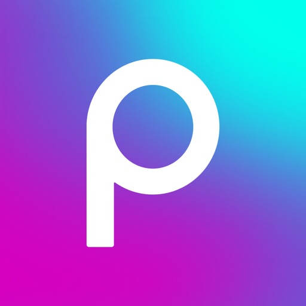
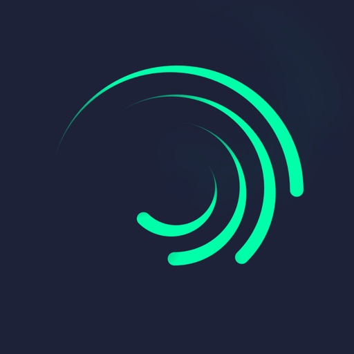

# YOUTUBE PREMIUM ON IOS

### The Loon Collection

Your apps. Your preferences. One place to get started.

[Installation](#getting-started) · [Plugins](#4-choose-your-plugins) · [Settings](#make-it-yours) · [Contact Showrov](https://t.me/montouch)

---

## Getting started

### 1. Install Loon

> [!IMPORTANT]
> **Apple ID available with Loon already purchased**
>
> Loon is a paid app and is required to use these plugins.
>
> **[Get the shared Apple ID for Loon](https://showrov-apple-id.showrovbd.workers.dev/)** — open the sharing page to copy the account details and follow the App Store installation guide. Available to everyone.
>
> Need help? **[Contact Showrov](https://t.me/montouch)**.

You can also [purchase Loon directly from the App Store](https://apps.apple.com/app/loon/id1373567447).

1. Install **Loon 3.5.3 (1014) or later**.
2. Open Loon and allow it to add a VPN configuration when iOS asks.

### 2. Install and trust your certificate

1. In Loon, open **MitM / HTTPS Decryption** and generate a certificate, then choose **Install Certificate**.
2. Allow the certificate profile to download.
3. Open iPhone **Settings → General → VPN & Device Management**. Select the downloaded Loon certificate profile and tap **Install**.
4. Go to **Settings → General → About → Certificate Trust Settings** and enable **full trust** for the certificate you just installed.
5. Return to Loon and select that certificate for MitM.

Create and use your own certificate. Keep its files private.

### 3. Enable the required settings

In Loon, enable:

| Setting | Required state |
| :-- | :-- |
| JavaScript / Script | **On** |
| Rewrite | **On** |
| MitM / HTTPS Decryption | **On**, with your trusted certificate selected |
| Loon connection | **On** |

Labels may vary slightly with the app language. If you already have a Loon configuration, keep it and add the plugins below.

### 4. Choose your plugins

Open this page on your iPhone and tap **Add to Loon**, then confirm the import. For manual setup, copy the **Plugin URL** into Loon’s plugin list.

| Plugin | Install | Manual setup |
| :-- | :--: | :--: |
|  **YouTube** | [Add to Loon](https://www.nsloon.com/openloon/import?plugin=https%3A%2F%2Fraw.githubusercontent.com%2Fshowrovbd%2Fyoutubepremiumios%2Floon-preview%2Floon%2Fapps%2FShowrov-YouTube.lpxe) | [Plugin URL](https://raw.githubusercontent.com/showrovbd/youtubepremiumios/loon-preview/loon/apps/Showrov-YouTube.lpxe) |
|  **Spotify** | [Add to Loon](https://www.nsloon.com/openloon/import?plugin=https%3A%2F%2Fraw.githubusercontent.com%2Fshowrovbd%2Fyoutubepremiumios%2Floon-preview%2Floon%2Fapps%2FShowrov-Spotify.lpxe) | [Plugin URL](https://raw.githubusercontent.com/showrovbd/youtubepremiumios/loon-preview/loon/apps/Showrov-Spotify.lpxe) |
|  **Picsart** | [Add to Loon](https://www.nsloon.com/openloon/import?plugin=https%3A%2F%2Fraw.githubusercontent.com%2Fshowrovbd%2Fyoutubepremiumios%2Floon-preview%2Floon%2Fapps%2FShowrov-PicsArt.lpxe) | [Plugin URL](https://raw.githubusercontent.com/showrovbd/youtubepremiumios/loon-preview/loon/apps/Showrov-PicsArt.lpxe) |
|  **Alight Motion** | [Add to Loon](https://www.nsloon.com/openloon/import?plugin=https%3A%2F%2Fraw.githubusercontent.com%2Fshowrovbd%2Fyoutubepremiumios%2Floon-preview%2Floon%2Fapps%2FShowrov-AlightMotion.lpxe) | [Plugin URL](https://raw.githubusercontent.com/showrovbd/youtubepremiumios/loon-preview/loon/apps/Showrov-AlightMotion.lpxe) |
|  **Truecaller** | [Add to Loon](https://www.nsloon.com/openloon/import?plugin=https%3A%2F%2Fraw.githubusercontent.com%2Fshowrovbd%2Fyoutubepremiumios%2Floon-preview%2Floon%2Fapps%2FShowrov-Truecaller.lpxe) | [Plugin URL](https://raw.githubusercontent.com/showrovbd/youtubepremiumios/loon-preview/loon/apps/Showrov-Truecaller.lpxe) |

Add each plugin once. Keep only one enabled copy of each plugin.

### 5. Enable your plugins

1. Open the imported plugin and follow the setup instructions in its description.
2. Save the settings and enable the plugin.
3. Keep Loon connected, then close and reopen the target app.

### 6. Finish Spotify setup

After installing or updating the Spotify plugin, **keep Loon and the plugin enabled, sign out of Spotify, then sign in again**. Set audio quality to **Normal** and avoid **Very High**.

## Make it yours

Open a plugin’s settings in Loon to adjust its available options.

**[YouTube settings guide](https://github.com/showrovbd/youtubepremiumios/blob/loon-preview/loon/apps/YouTube.md)** — player controls, captions, feed filters, sharing and more.

| Option | What it does |
| :-- | :-- |
| **YouTube → Hide Shorts Tab** | Hides the Shorts navigation entry. Default: **Off**. |
| **YouTube → Hide Create / Upload** | Hides the Create/upload navigation entry. Default: **On**. |
| **YouTube → Hide Immersive Music Tab** | Hides the immersive Music navigation entry. Default: **On**. |
| **YouTube → YouTube Premium Logo** | Shows the Premium wordmark in supported headers. Default: **Off**. Changes appearance only. |
| **Spotify → Album and Artist Layout** | Uses the tablet layout for album and artist pages. Default: **On**. |

To use the Premium header, turn on **YouTube Premium Logo**, save, then fully close and reopen YouTube. Turn it off to use your account’s default logo.

Restart the target app after changing appearance or layout options. Navigation options apply where the app provides the corresponding entries.

## Stay up to date

In Loon’s plugin list, use **Update** on the existing entry. Your plugin URL stays the same, so you do not need to add another copy. Review the plugin description after updating for the latest setup instructions.

## Need a hand?

First check that Loon is connected, your plugin is enabled, and **Script**, **Rewrite** and **MitM** are on. Confirm that the Loon certificate is installed and fully trusted.

For help, **[Contact Showrov](https://t.me/montouch)** with the app name, plugin version and a short description of the issue. Keep personal information and certificate files out of public issues.

---

**Setup · Updates · Support**

[Contact Showrov](https://t.me/montouch)

[Licenses](https://github.com/showrovbd/youtubepremiumios/blob/loon-preview/loon/LICENSE) · Third-party notices are included with the plugins.

